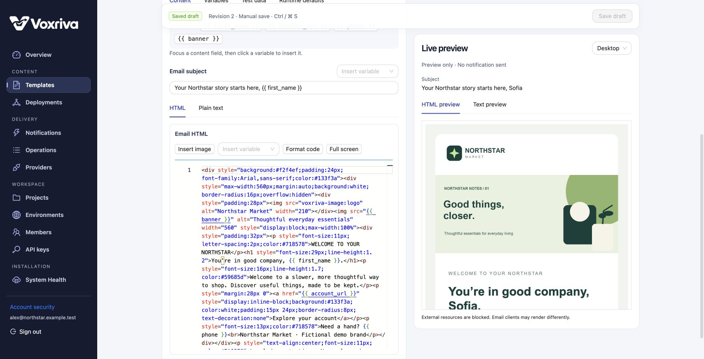

# Voxriva

**Open-source, self-hosted email and push notifications.**

Manage notification templates, languages and deployments in a web dashboard.
Integrate through the HTTP API or typed Python SDK, and use MCP for AI-assisted
draft editing. Release content independently of your application, with delivery
data and provider credentials in your infrastructure.

**MIT license · Self-hosted · Web dashboard · HTTP API · Python SDK · MCP**

[Run locally](voxriva/docs/quickstart.md) · [Dashboard](voxriva/docs/dashboard.md) ·
[API & SDK](voxriva/docs/journeys/integrate.md) · [MCP](voxriva/docs/journeys/mcp.md) ·
[Documentation](voxriva/docs/index.md)

- **Change content without an application release.** Preview templates, manage
  languages, publish immutable versions and deploy or roll back each environment.
- **Keep control of delivery.** Run the service yourself, connect SMTP, Amazon SES
  or Firebase Cloud Messaging, and keep credentials and message data in your infrastructure.
- **Understand each notification.** Validate payloads before sending, retry HTTP
  requests with idempotency, and inspect the exact template, provider and attempts.

[](voxriva/docs/dashboard.md)

*Edit → preview → publish → deploy. The dashboard combines an HTML/Jinja editor
with a live preview, version management and delivery history.*

## Try it locally

Have Docker Engine with Compose v2 running and Python 3.10+ on macOS/Linux.
The first build downloads dependencies and can take several minutes. No cloud
account, provider credentials, host Node.js or Python packages are needed.

```sh
git clone https://github.com/AlexIvanchyk/Voxriva.git
cd Voxriva/voxriva
python3 scripts/example.py
```

Already have a checkout? Run the launcher from its `voxriva/` directory. It creates
an isolated fictional workspace, sends a welcome email to local Mailpit, and
prints the dashboard, inbox and private login-file locations. Follow
[the quickstart](voxriva/docs/quickstart.md) to send your own API request.

## Send from your application

After the quickstart loads `VOXRIVA_URL` / `VOXRIVA_API_KEY` and you
[install the SDK](voxriva/docs/journeys/integrate.md#configure-a-local-client):

```python
import os
from voxriva_sdk import Client

with Client(os.environ["VOXRIVA_URL"], os.environ["VOXRIVA_API_KEY"]) as client:
    accepted = client.send(
        "northstar-welcome", recipient="person@example.test", locale="en",
        context={"first_name": "Taylor", "account_url": "https://northstar.example.test/account"},
        idempotency_key="docs:welcome:001",
    )
    print(accepted.id, accepted.dashboard_url)
```

The same operation is available through the [HTTP API](voxriva/docs/api.md).
[MCP](voxriva/docs/journeys/mcp.md) lets an AI client read and propose template
drafts; publication and deployment stay explicit dashboard actions.

## Project and community

Voxriva's own code, dashboard, SDK and documentation use [MIT](LICENSE).
The default stack includes dependencies under other terms, including Redis 7.4
under source-available licenses. See [release status](voxriva/docs/release-status.md)
and [third-party notices](voxriva/THIRD_PARTY_NOTICES.md) for the current prerelease
and redistribution boundaries.

[Self-hosting](voxriva/docs/self-hosting.md) · [Contributing](CONTRIBUTING.md) ·
[Support](SUPPORT.md) · [Security](SECURITY.md) · [Code of Conduct](CODE_OF_CONDUCT.md) ·
[Changelog](CHANGELOG.md)
