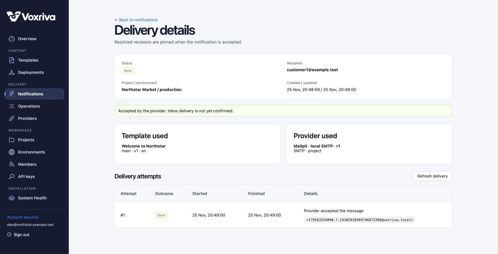

# Delivery HTTP API

Base path: `/api/v1`. JSON requests use `Content-Type: application/json` and
`Authorization: Bearer <environment-delivery-key>`. Runtime POSTs do not accept
a dashboard session or Template / MCP token as a substitute. An inactive key
returns HTTP 401 and `WWW-Authenticate: Bearer`.

## Endpoints

| Method/path | Authentication | Result |
| --- | --- | --- |
| `POST /notifications/validate` | Delivery key | 200 preflight result; no job or transport call |
| `POST /notifications` | Delivery key + Idempotency-Key | 202 accepted notification, including idempotent repeats |
| `GET /notifications/{id}` | Same environment's Delivery key or permitted dashboard session | 200 scoped status, resolution, attempts and provider events |
| `GET /notifications` | Dashboard session | Scoped paginated history; not a Delivery-key list endpoint |
| `POST /notifications/{id}/replay` | Dashboard session + CSRF + authorized role | 202 new linked notification for an eligible Failed record |
| `GET /delivery/scope` | Delivery key | Project/environment scope of the credential |
| `GET /health/live`, `GET /health/ready` | Public | Liveness; dependency readiness (503 when unavailable) |

An explicit Authorization header on status retrieval selects bearer validation;
an invalid bearer does not fall back to a valid dashboard cookie. A notification
outside the key's environment is 404. Dashboard history can expose an authorized
email recipient; Delivery-key responses mask it. Device tokens stay hidden.

## Request body

```json
{
  "template_key": "northstar-welcome",
  "recipient": "person@example.test",
  "locale": "en",
  "context": {
    "first_name": "Taylor",
    "account_url": "https://northstar.example.test/account"
  }
}
```

| Field | Contract |
| --- | --- |
| `template_key` | Required; `[a-z][a-z0-9_-]{0,99}`; connected to the key's project |
| `recipient` | Email target; exactly one of recipient/device_token; must match an email template |
| `device_token` | Push target; 16–4096 characters from `[A-Za-z0-9:._%~+=-]`; must match a push template |
| `locale` | Defaults to `en`; 2–35 characters, validated language/subtag syntax, normalized to lowercase |
| `context` | JSON object, defaults to `{}`; validated after merging explicit published runtime defaults |

Unknown top-level request members are rejected. The published variable schema
controls context's property rules; the request model does not make every context
schema closed by default. Nonimage context is bounded to 100,000 UTF-8 bytes;
[images](email-images.md) have separate budgets. The rendered email must have a
nonempty subject with no CR/LF and a nonempty text or HTML body. Push requires a
nonempty title/body and a complete FCM request of at most 4096 bytes.

## Acceptance response

A new acceptance and an idempotent repeat both return **202** with
`Location: /api/v1/notifications/{id}`. Parse the returned ID; do not construct a
fixture ID or infer it from a template/version number.

| Field | Meaning |
| --- | --- |
| `id` | Notification UUID |
| `status` | Current state; new acceptance is `queued`, a repeat may be terminal |
| `environment_id` | Scope selected by the key |
| `template_version_id` | Immutable content revision pinned at original acceptance |
| `provider_revision_id` | Exact provider/credential revision pinned at original acceptance |
| `replayed` | `true` means an idempotency-key hit, not an operator replay |
| `status_url` | Relative authenticated status endpoint |

The commit guarantees notification and outbox existence together. It does not
guarantee that Redis publication or a provider call has happened. Broker outages
can leave accepted work queued until relay recovery; the broker does not
participate in acceptance. See [delivery states and recovery](journeys/operate.md).

## Idempotency

`Idempotency-Key` is required for send, 1–128 ASCII letters/digits or `. _ : -`.
Scope is the environment, not the individual active credential. The server
fingerprints the validated request model (including target, context, template
key and normalized locale) using the installation keyring.

A matching request returns its original notification before new deployment/
provider resolution. A different payload with that key is 409. JSON object-key
order does not change the canonical fingerprint; changing supplied context or
omission into an explicit value can. Default merging happens later, so omitting
a field and explicitly supplying its default are not interchangeable retry bodies.
Persist both the business-operation key and original payload across restarts.
Concurrent unique-key conflicts are reconciled against the committed winner.

There is no short idempotency TTL in this implementation: keys remain attached
to retained notification records. Runtime payload expiry does not expire the
idempotency record. Retain historical encryption keys needed for fingerprint
comparison after keyring rotation.

## Validation result

Preflight returns `valid: true`, `project_id`, `environment_id`, `channel`,
requested `locale`, `resolved_locale`, `fallback_used`, `template_version_id` and
`provider_revision_id`. It returns no rendered content or recipient. It validates
provider configuration/decryptability but makes no network probe, reserves no
version and creates no notification/outbox/attempt/audit row.

## Errors

The error envelope is `{"detail": ...}`. Detail can be a string, request-validation
issue list (`loc`, `msg`, `type`), or runtime problem with `message` and `issues`
(`path`, `code`, `message`). Do not parse human-readable message text for control
flow; use status and structured issue metadata. Invalid runtime data does not
create a notification or outbox record.

| HTTP status | Runtime condition |
| --- | --- |
| 401 | Missing/invalid/revoked/expired Delivery key; includes WWW-Authenticate |
| 404 | Template not connected to this project, no explicit deployment/fallback, or status lookup outside scope |
| 409 | Key reused with a different request; a concurrent scope change may also require retry |
| 422 | Request/header validation, channel/target mismatch, schema/render/image failure, invalid email/push shape, missing/unavailable provider or disallowed SMTP host |
| 429 | Runtime renderer has no free slot; no universal Retry-After header is supplied by this path |
| 503 | Pinned provider settings cannot be loaded/decrypted |

Dependency/process/proxy failures can additionally produce network failures or
5xx responses outside those application decisions. An unconfirmed response can
follow a committed acceptance: retry the original key/body. The server does not
promise automatic HTTP retries or expose raw provider exceptions. Preview's
per-account rate limit has its own Retry-After behavior; do not infer it for
runtime acceptance.

## Status and replay

Status includes `resolution` (saved names, branch/version, resolved locale,
fallback and provider scope), attempt timestamps/outcomes, `next_attempt_at`,
`expires_at`, `payload_available`, `replay_of_id` and verified provider events.
Current states are `queued`, `retrying`, `processing`, `sent`, `delivered`,
`bounced`, `failed`, `unknown`. `expires_at` is the runtime payload deadline, not a
promise to delete technical history then.

Operator replay is a management operation, not a Delivery-key resend. It requires
`replay_key`, `expected_updated_at`, and optionally
`use_current_deployments`, a channel-appropriate target and context. The target
and context must be supplied together when replacing expired input. Only Failed
records are eligible; Unknown returns 409. See [replay and uncertainty](journeys/operate.md).

[](assets/screenshots/delivery-details.jpg){ .doc-media-link }

*The existing detail frame ties an actual local SMTP attempt to its accepted
content and provider revisions. The IDs are capture-specific, not fixtures to copy.*

The [checked-in delivery v1 OpenAPI contract](../contracts/delivery-v1.openapi.json)
covers acceptance, validation, status and public health. Administration/history
listing/replay are outside that frozen SDK contract. The running API's `/docs`
exposes the broader current OpenAPI surface.
