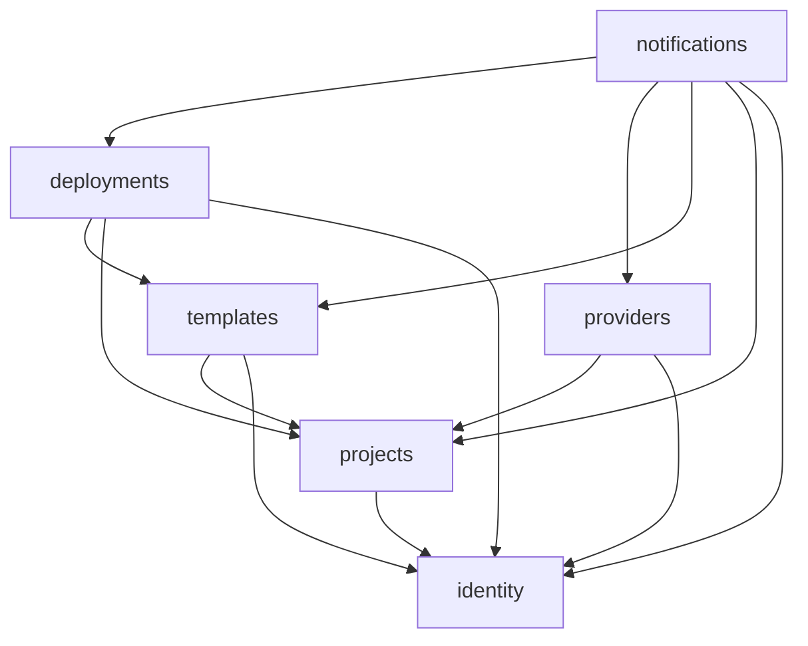

# Voxriva modular monolith

This is a modular monolith with separately runnable API, MCP, relay and channel
workers. Domain services own permission/transaction invariants; HTTP routers and
process entrypoints adapt them to their transport. The following boundaries keep
runtime contracts stable while features evolve.

## Backend ownership

Canonical modules are under `backend/app/features`:

| Feature | Responsibility |
| --- | --- |
| identity | Accounts, sessions, authorization and audit helpers |
| projects | Projects, environments, membership, delivery keys and scopes |
| templates | Drafts, languages, rendering, preview and authoring validation |
| deployments | Immutable versions, resolution, promotion and rollback |
| providers | Configuration revisions, bindings, provider events and adapters |
| notifications | Acceptance, history, outbox, workers, replay and recovery |
| system | Monitoring and health information |
| management | Scoped authoring credentials and transport-independent MCP orchestration |

`backend/app/infrastructure` owns settings, process resources, database metadata,
the explicit `model_registry.py`, secret-key generation and broker bootstrap. There must be one SQLAlchemy declarative Base. The model
registry imports every feature model before migrations or metadata-based tests run.
It is the intentional infrastructure-to-feature composition exception.
Model modules may reference other tables by foreign-key names; do not create
another Base to resolve an import cycle.

HTTP routers adapt request data and declare dependencies, status codes and response
schemas. Application workflows belong in services. Rendering, compatibility,
resolution and retry decisions should remain directly testable. Share a service
function or schema across features; never import another feature's router as a
business library. Keep transactions around the workflow that establishes an
invariant, including notification + outbox insertion. Do not hide commits inside
a generic repository for each table. Delivery provider calls occur after the
claim transaction; fencing tokens protect the final state transition.

Provider I/O must use adapters with synthetic inputs in tests. Importing delivery
algorithms must not instantiate Celery, open database connections or read secret
files. Process entrypoints may create their configured resources explicitly.

## Frontend ownership

`frontend/src/app` composes routes, layout and providers. `features` contains
session, projects, members, templates, deployments, providers, notifications and
system screens and their behavior. `shared/api`, `shared/ui`, `shared/lib` and
`shared/styles` contain reusable building blocks.

Dependencies point from app to features/shared and from features to shared. Shared
code cannot import features or app; features cannot import app. Put screen-specific
logic beside its screen. Keep lifecycle history, publication review, published
preview and deployment controls independently understandable. API errors, loading,
empty states, session expiry and disabled actions remain user-visible behavior.

## Adding a feature

1. Choose the owner of the workflow and its transaction. Reuse another feature's
   service through an explicit interface when needed.
2. Add schemas, a service and a router when they carry distinct responsibilities;
   split queries only when doing so improves reuse or readability.
3. Register owned models in the shared metadata registry and add an additive
   migration when persistence changes. Preserve existing migration revisions.
4. Add synthetic factories and external-service doubles in test support. Write
   unit tests for decisions and integration tests for SQL/transactions.
5. Place UI behavior in its feature and route composition in app. Put genuinely
   reusable primitives in shared; keep shared free of feature dependencies.
6. Run architecture, backend, frontend, SDK and contract checks. Use PostgreSQL
   tests for lock-sensitive changes and Compose E2E for process integration.

## Dependency checks

`make test-architecture` rejects flat backend application modules, FastAPI imports
in services, imports of HTTP routers from business code, infrastructure-to-feature
dependencies outside the model registry, imports between test suites, and upward
frontend layer dependencies. The narrow external provider contract is outside canonical feature implementation. The checker intentionally does not outlaw all
cross-feature service dependencies: this application is a modular monolith.

`make test-contract` compares generated delivery OpenAPI with the frozen snapshot
without rewriting it. A mismatch requires compatibility review. Do not silently
run `freeze-delivery-contract` to make the check green.


## Package layout and supported import exception

```text
backend/app/
  __init__.py
  main.py                    # Composition, lifespan, middleware, static dashboard
  features/
    identity/                # router, dependencies, schemas, service, models, bootstrap
    projects/                # project/environment/key and member workflows
    templates/               # authoring, rendering, locales, drafts and versions
    deployments/             # resolution, environment assignments, promotion/rollback
    providers/adapters/      # SMTP, cloud providers, crypto, registry
    notifications/           # acceptance, history, delivery, recovery, worker, operations
    system/                  # health router/schemas, monitoring, collector
  infrastructure/            # settings, DB/Base/registry, resources, broker, errors, HTTP context
  shared/provider_contract.py
  providers/base.py          # Explicit public plugin exports only
```

`backend.app.providers.base` is retained because the README documents it as the
external provider-plugin API (interface version 1). It explicitly re-exports the
shared provider contract; it contains no `sys.modules` alias. Internal modules use
`shared.provider_contract`. Other old flat modules and provider adapter wrappers
were removed. The packaged example references the canonical built-in SMTP
adapter when demonstrating inheritance; new standalone transports should implement
the public contract rather than depend on internal adapter implementations.

Process entrypoints are `backend.app.main:app`,
`python -m backend.mcp_server` (standalone template-authoring MCP),
`python -m backend.mcp_credentials` (dashboard-authenticated credential CLI),
`backend.app.features.notifications.worker:celery_app` (Celery),
`python -m backend.app.features.notifications.worker` (relay),
`python -m backend.app.features.identity.bootstrap`,
`python -m backend.app.features.system.collector` and
`python -m backend.app.infrastructure.secrets`.

Test support lives under `tests/support`, with shared integration fixtures in
`tests/integration/conftest.py`. Unit tests collect without importing the HTTP app.
Browser suites live under `frontend/e2e` by scenario, with shared support under
`frontend/e2e/support` and one worker because scenarios intentionally exercise
shared process availability (including Redis/API outages).

## Application-service dependency map

The cross-feature service imports form the following directed graph (model
and schema references are omitted). Notifications orchestrates resolution, provider
selection, authorization and rendering; feature services do not call HTTP routers.



The HTTP dependency modules may read request cookies, bearer headers and application
state. Services receive plain SQLAlchemy sessions, principals, schemas and an
`ApplicationContext`. `ApplicationError` crosses this boundary and the composition
root translates it into the established HTTP status/detail representation. HTTP
`Location` headers, login/logout cookies, webhook body reading and monitoring-token
checks stay in routers/dependencies. This preserves existing API responses while
allowing workflows to run without constructing a FastAPI request.


## Test boundaries

Use isolated unit tests for decisions that do not depend on SQL: rendering,
compatibility and retry calculations. Resolution, locale fallback, authorization
scoping and delivery transitions are also exercised through HTTP/database
integration tests so the actual queries and transaction behavior are checked.
Mock external transports rather than replacing the database query API with mocks.
PostgreSQL-only tests establish row-lock, concurrency and rollback behavior that
SQLite cannot represent. A fresh-process bootstrap test catches incomplete model
registration that a fully imported API/test process can otherwise hide.
