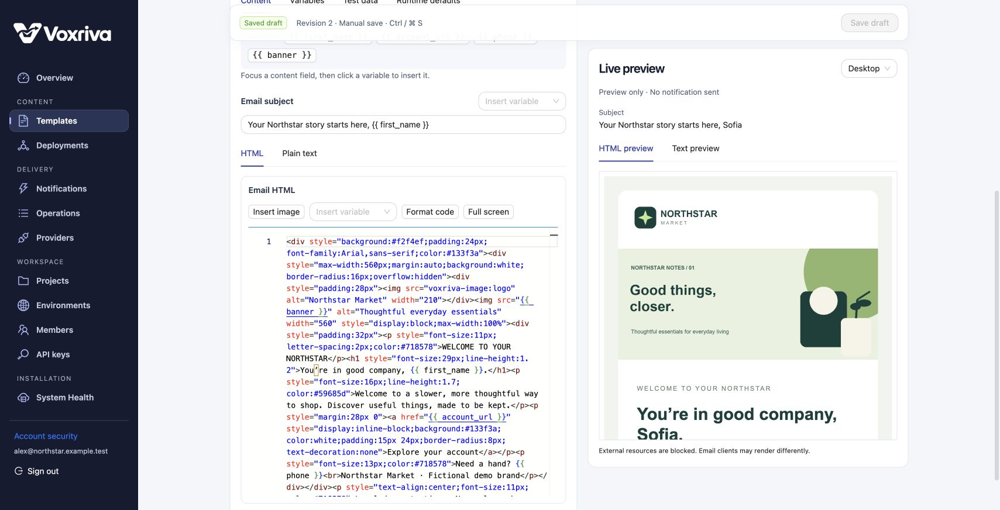

# Product capabilities

Voxriva combines a web dashboard for content and operations with an HTTP delivery
API, a typed Python SDK and scoped MCP authoring. For a first look, use the
[overview](index.md) or [run locally](quickstart.md).

## Versioned content with explicit activation

Email templates contain subject, HTML and plain text; push templates contain
title, body and string-valued data. Each template has a typed JSON Schema input
contract, fictional preview fixtures, named scenarios and separate runtime
defaults. The same bounded renderer serves preview and runtime validation.

Languages and branches are first-class. Drafts can evolve independently, publish
immutable versions and deploy those versions to explicit environment or default
slots. Publishing does not activate content. A team can test v2 in development,
keep production on v1, then deploy the same tested version or roll a target back.
Schema compatibility checks flag changes that may break existing callers.

Static email images and typed Image values are supported as validated local
PNG/JPEG/WebP bytes. They are stored with immutable content or encrypted runtime
payloads and delivered as inline CID attachments. Rendering does not fetch
remote images or schemas.

{ .doc-media-link }

*The existing editor capture shows HTML, typed variable references and an isolated
rendered preview. It is an authoring check, not a send operation.*

## A runtime contract applications can depend on

A Delivery key identifies one project/environment. Requests supply the template
key, a recipient or device token, an explicit locale and JSON context. Accepted
notifications pin both the immutable template version and provider revision;
later deployments or credential revisions do not rewrite queued work.

The API provides side-effect-free preflight validation, environment-scoped
idempotency and status retrieval. The independent Python SDK supplies synchronous
and asynchronous clients, typed results/errors, bounded HTTP retries, health
methods and an image-byte helper. The checked delivery v1 OpenAPI contract covers
these runtime operations; dashboard administration has a separate API surface.

## Delivery through providers you configure

| Provider | Channel | Transport and observable result |
| --- | --- | --- |
| SMTP | Email | STARTTLS/implicit TLS or explicitly configured local SMTP; Sent records SMTP acceptance |
| Amazon SES v2 | Email | Workload credentials or encrypted access keys; signed SNS events can establish Delivered/Bounced |
| Firebase Cloud Messaging HTTP v1 | Push | Service account or workload credentials; Sent records FCM acceptance, without claiming device receipt |
| Installed Python adapters | Adapter-defined email/push transport | Trusted entry-point plugins with configuration schemas, capabilities and normalized outcomes |

Provider configuration is versioned and separate from templates. Bind an exact
revision to an environment/channel or a project/global default. A configuration
edit creates a new revision; it does not silently move existing bindings.
Connection probes, explicit test sends and normal queued delivery are distinct
operations.

## Durable acceptance and inspectable failure behavior

HTTP 202 follows the atomic PostgreSQL notification/outbox commit. A relay then
publishes ID-only tasks to Redis; channel-specific Celery workers load the pinned
content and credentials. Broker publication and external provider delivery happen
after acceptance and are not part of that database transaction.

Workers use fenced renewable claims, bounded safe retries and conservative
recovery after crashes. History retains attempts, normalized errors, resolution
metadata and verified provider events. An eligible Failed notification can be
replayed as a new linked record; the original remains unchanged. A send whose
external acceptance is uncertain becomes Unknown and is not blindly retried.
This is not an exactly-once external-delivery guarantee.

## Project boundaries and self-hosted operations

Projects have independent memberships, roles and environments. A shared template
can connect to multiple projects while enforcing read/write permissions across
those connections. Delivery credentials are separate from scoped Template / MCP
credentials and dashboard sessions. Accounts support optional or required TOTP
MFA with recovery codes.

The runtime is a modular monolith using PostgreSQL, Redis and separate API,
relay, email-worker and push-worker processes. Local Compose includes Mailpit.
The production Compose configuration adds HTTPS, file-backed secrets, non-root
processes, private database/broker access, migrations and coordinated
**database + full encryption-keyring** backup/restore tooling. Operational views
and protected metrics expose backlog, worker health and delivery outcomes.

## Where it fits

Typical integrations include account emails, receipts or order updates emitted
by application events, localized transactional messages, and push notifications
addressed to tokens already owned by the calling application. Multiple projects
can reuse one content library while selecting different provider/version bindings
for development, staging and production.

The application retains business scheduling, recipient ownership, preferences
and suppression decisions. Voxriva does not provide campaigns, a subscriber
CRM, SMS/WhatsApp or a visual business-workflow engine. There is no mandatory
hosted control plane or maintainer telemetry account. Cloud providers require
your own accounts; local SMTP does not.

## Evaluate limits and deployment scope

Review [payload and renderer limits](limits.md), [self-hosting](self-hosting.md),
and [release status and compatibility](release-status.md) before a production integration.
