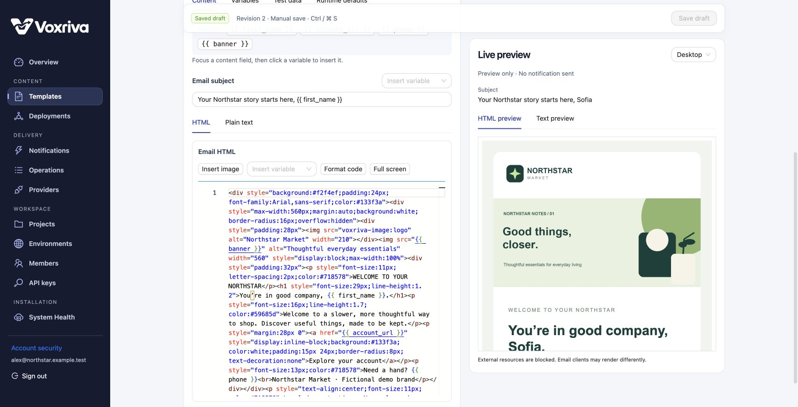

# A dashboard for your team

Change notification content, manage releases and investigate delivery from one
web interface. Application code keeps calling a stable template key while your
team updates the content independently.

[Run the local example](quickstart.md) and open its printed dashboard URL. The
launcher prints the location of the private login file; the example already has
a project, environment, template, deployment and local SMTP provider.

## Edit → preview → publish → deploy

1. Open **Templates** and select `northstar-welcome` in the example workspace.
2. Edit the subject, HTML/Jinja or plain text. Use typed variables and fictional
   test data to check the live preview. Previewing sends no email.
3. Save the draft. Review the preview and input contract, then publish an immutable
   version. Publishing leaves the active deployment unchanged.
4. Open **Deployments** to select the published version for the target environment
   and locale. Future accepted requests use that version; queued work keeps its
   original revisions. Select an earlier version to roll a target back.

{ .doc-media-link }

*The email editor provides HTML/Jinja and plain-text code editing with a live
rendered preview, variable insertion and image upload.*

Languages and branches let you prepare another locale or version separately.
See [template contracts](journeys/email.md), [languages](journeys/languages.md)
and [version/deployment rules](journeys/lifecycle.md) for the complete workflow.

## See what ran and recover deliberately

Open **Notifications** to inspect an accepted request, its exact template/provider
revisions, status and attempts. Use **Operations** for backlog and worker health.
Authorized operators can replay eligible Failed notifications as new linked
records; Unknown outcomes require investigation before another send.

Sent records provider acceptance. Verified supported provider events can establish
Delivered or Bounced. [Delivery semantics](journeys/operate.md) explains those
states and the available recovery actions.

## Give each person the access they need

| Person | Typical work |
| --- | --- |
| Template editor | Edit connected content, preview, manage languages and prepare versions |
| Project administrator | Manage project members, environments, keys and provider bindings |
| Operator | Inspect delivery and replay eligible failures |
| Viewer | Read the content and operational information their project role permits |
| Installation administrator | Bootstrap accounts and manage installation-wide settings |

Memberships are independent per project. Shared-template writes check access
across every connected project. See [projects, members and keys](journeys/workspace.md)
and the [complete editor and permission reference](workspace-guide.md).

For application integration, open **API keys → Delivery → Examples**. For scoped
AI-assisted authoring, use **API keys → Template / MCP → Connect** and the
[MCP walkthrough](journeys/mcp.md). Accounts can enroll in [TOTP MFA](mfa.md).
