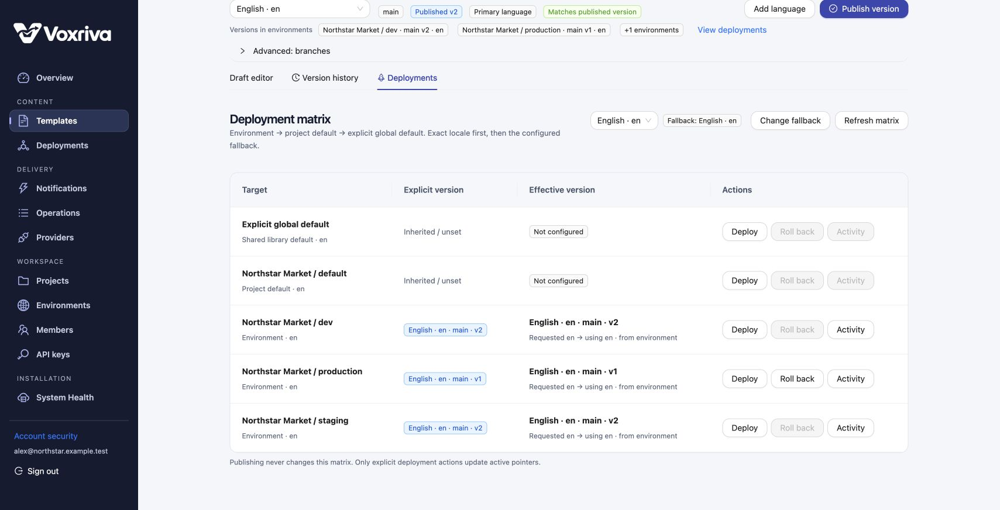

# Versions, deployments and resolution

A stable template key is the application-facing name. A draft revision, a
published branch-local version number and a deployment generation are different
concurrency/version identifiers. Do not substitute one for another or select
"the latest" version in calling code.

## Immutable snapshots and explicit pointers

Publication validates the saved draft and freezes content, schema, runtime
defaults, fixtures and lineage. `main / v2 / en` and `candidate / v1 / en` are
distinct snapshots; version numbers are local to the branch. Published content
and deployment events are immutable, and templates with published history
cannot be deleted through ordinary template deletion.

A deployment points an environment, project default or explicit global default
to a particular published snapshot for a locale. Publishing v2 leaves every
existing pointer unchanged. Promotion/deploy selects the same tested immutable
version for another target; rollback selects a version previously used by that
exact target/locale. Neither action rewrites accepted notifications.

Provider bindings are independent pointers to provider revisions. Saving a new
SMTP password/configuration revision does not move bindings. Even a retained
pinned credential can fail if the remote provider invalidates it later.

{ .doc-media-link }

*In this existing capture, dev/staging select main v2 while production selects
main v1. A publication alone does not change those pointers.*

## Locale resolution at acceptance

The API validates/lowercases the requested locale, then tries:

1. Exact requested locale: **environment → project default → explicit global default**.
2. Only if that fails, the same chain for the template's configured fallback locale.
3. If no explicit pointer resolves, HTTP 404; no arbitrary published/latest version.

There is no implicit `uk-UA` → `uk` truncation. A requested `uk-UA` may resolve
the configured `en` fallback even if a `uk` version exists. API/SDK calls omitted
locale default to `en`; changing the editor's primary language does not change
that API default. Template creation initializes fallback from its selected
primary language. Later primary-editor and delivery-fallback changes are separate.

The template must be connected to the key's project, and the environment must
belong to that project. No cross-project deployment fallback is permitted.
The resolved template version and provider revision are pinned before acceptance.
An idempotency repeat returns its original pinned notification before re-resolving
current deployments.

## Optimistic mutations

| Operation | Guard / result |
| --- | --- |
| Draft save | branch_id and expected_revision; stale edit returns 409 |
| Publish | Saved draft revision; content/schema/default/fixture checks |
| Deploy/rollback/clear | expected_generation for the target slot |
| Promote | Source and target generation checks |
| Fallback change | Expected current locale and explicit acknowledgement when active resolutions may change |
| Dashboard deployment review | Also sends expected effective version to detect parent/fallback changes |

Clearing a slot retains its generation, preventing stale requests from reusing
an old state. On 409, reread current state and review the change before retry.
If a save response is lost, reconcile server state before deciding it failed.

Variable-contract comparison flags new required fields without defaults, removed
properties, narrowed types/constraints and removed required defaults. Breaking
activation/rollback requires explicit acknowledgement server-side. This is a
conservative compatibility check, not a solver proving every possible JSON Schema
relationship. Update application payloads deliberately before activating an
incompatible contract.

## Management surface

Routes under `/api/v1/templates/{id}` include `/branches`, `/publish`, `/versions`,
version `/preview`, `/versions/diff`, `/fallback`, `/deployments` and explicit
`/deployments/deploy`, `/promote`, `/rollback`, `/clear` mutations. The side-effect-free
management resolver is
`GET /api/v1/projects/{project}/environments/{environment}/templates/{template}/resolve?locale=en`.
Use actual IDs returned by management APIs; these routes are not the frozen
Delivery SDK surface.

[MCP](../../MCP.md) can create languages/branches and save drafts, but does not
publish/deploy. The [workspace/editor reference](../workspace-guide.md) documents
the corresponding UI. Database restore is a separate production operation;
content rollback is not permission to downgrade a schema. See
[upgrade/rollback](../../PRODUCTION.md#upgrade-and-rollback).
