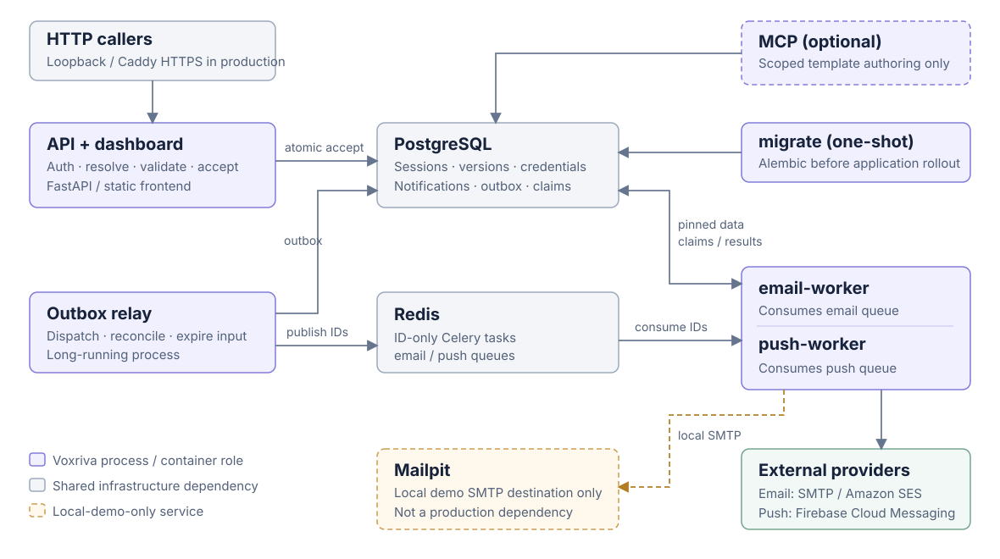

# Runtime architecture and boundaries

Voxriva manages notification content and technical delivery. Your application
retains business events, scheduling, recipient ownership and user preferences.
There is no subscriber database, campaign engine or hosted control plane to adopt.

## Runtime topology

*Application roles share one codebase and database. PostgreSQL/Redis are separate
infrastructure; Mailpit is only a local SMTP destination. The diagram omits local
key-setup/collector jobs and health-probe traffic. Production Caddy terminates
HTTPS in front of the API; the optional MCP overlay can route /mcp through it.*

**External PostgreSQL/Redis:** application roles read the SQLAlchemy asyncpg URL
from `VOXRIVA_DATABASE_URL` or `VOXRIVA_DATABASE_URL_FILE`, and the broker URL
from `VOXRIVA_REDIS_URL`. They can connect to operator-managed services. The
shipped production Compose still hardcodes its internal Redis URL and depends
on the bundled PostgreSQL startup/migration service. Moving those dependencies
outside the stack needs an explicit deployment configuration: connection secrets,
network/TLS requirements, revised startup dependencies and a matching migration
job. The bundled backup/restore scripts execute tools in the Compose postgres
service; they are not a turnkey managed-database backup workflow. See
[external dependency configuration](../configuration.md#external-postgresql-and-redis).

**Replication:** API processes can share database-backed sessions and state,
with a correctly configured ingress and common keyring/settings. Email and push
workers can replicate independently on their channel queues; PostgreSQL claims,
fencing and per-provider concurrency limits still govern job ownership. More
replicas do not bypass provider quotas or database capacity. Preview/request
limiters are process-local, so multiple APIs need ingress/shared-limit planning.
Migrations remain a coordinated one-shot operation. Keep one relay/reconciliation
role unless a multi-relay topology has been validated; its outbox polling is
technical dispatch/housekeeping, not an application business scheduler. No
autoscaler or highly available PostgreSQL/Redis topology is provisioned here.

## The request path

Your application submits a template key, a recipient or device token, a locale
and JSON context using a Delivery key. The key fixes the project and environment;
you do not select a different tenant inside the payload.

Before HTTP 202, the API resolves the deployed immutable template and provider
revisions, validates/renders the context, and commits the notification together
with its outbox record. The relay queues only its ID. An email or push worker
loads the pinned data, calls the provider and records the result.

| Concept | Your integration relies on |
| --- | --- |
| Project | A scope for members, environments and provider configuration |
| Environment | Independent delivery keys, deployments and provider bindings |
| Template key | Stable application-facing name, such as `welcome` |
| Draft | Editable content with its own optimistic save revision |
| Published version | Immutable content, schema and runtime defaults |
| Deployment | Explicit pointer selecting a published version for a target/locale |
| Provider revision | Pinned transport configuration and encrypted credentials |
| Notification | Accepted request, pinned revisions, attempts and current outcome |

Publishing alone does not activate a version. A deployment change affects future
acceptance; it does not rewrite an already accepted notification. This lets a
technical team release content without changing application code.

## Keep three kinds of input separate

- **Test data and scenarios** exist for previews and publication checks.
- **Runtime defaults** are explicit published values for missing top-level context.
- **Application context** is the actual request data and overrides each supplied
  top-level default. Nested objects are replaced as a whole.

JSON Schema `default` annotations do not supply runtime values. Preview and
`/notifications/validate` create no delivery job and call no provider.

## Authentication boundaries

Use a Delivery key for the SDK/API. Use a dashboard account for administration.
Use a separately scoped Template / MCP credential for AI-assisted authoring;
OAuth onboarding is not implemented. A delivery token cannot edit templates, and
an MCP credential cannot send notifications.

For product capabilities see the [overview](../index.md). Use
[local evaluation](../evaluate.md) or [API integration](integrate.md) independently. For implementation ownership see
[the modular monolith architecture](../architecture.md).
