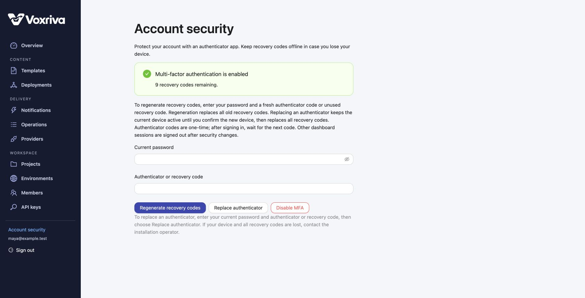

# Dashboard multi-factor authentication

Voxriva supports standard TOTP with Google Authenticator, Microsoft Authenticator,
1Password and other compatible authenticator apps. This is a second factor after
the account password, not social sign-in. No external authenticator service,
email delivery, SMS account or outbound request is required.

## Installation policy

`VOXRIVA_MFA_POLICY=optional` is the default: existing accounts and bootstrap keep
working, and each user may opt in from **Account security** in the sidebar footer.
`VOXRIVA_MFA_POLICY=required` blocks dashboard access until enrollment is confirmed.
Set it in the Compose environment file (production: `.env.production`) and recreate
API with your normal Compose command. Native deployments set the same environment
variable before starting the API. Unknown values fail settings validation.

In required mode, existing password-only sessions must sign in again. A correct
password produces a five-minute enrollment challenge with no dashboard session or
project permission. Scan/setup and confirm before accessing the dashboard; restart
sign-in if the challenge expires. Bootstrap can still create the first account;
that account follows the same enrollment requirement. Required mode prevents
self-service disable; authenticator replacement remains available after fresh verification. Switching back to optional permits self-service disable only
after password plus an existing factor; it does not bypass MFA for enabled accounts.
There is deliberately no policy that silently bypasses already enrolled factors.
Configure and back up the encryption keyring before enabling required mode.

## Enroll, use and replace a device

In **Account security**, enter your current password, select **Set up authenticator**,
and scan the local QR or enter the setup key manually. Use time-based SHA1, six
digits, thirty seconds. Enter one code to activate; pending setup expires after ten
minutes. In required onboarding the enclosing sign-in challenge expires after five
minutes. The setup key/QR appears only during enrollment and cannot be retrieved
later. Existing other dashboard sessions are revoked when enrollment completes.

Save the ten recovery codes using Copy or Download before leaving. They are shown
once. Keep them offline, separate from your device. A code can replace the TOTP at
sign-in or during a security change and is consumed atomically once. Recoveries have
80 random bits each; only SHA256 digests are stored. Regenerating codes replaces the
entire previous set and requires a fresh password plus TOTP or unused recovery code.
Disable has the same checks and revokes other dashboard sessions and all challenges.

After entering the password at sign-in, enter an authenticator or recovery code.
Previously accepted TOTP time steps cannot be reused, including the enrollment
code. Wait for the next code if necessary. Synchronize server and device clocks.
The allowed window is the current step plus one step on each side (clock skew).
Five failed proofs across sign-ins and security operations lock the account's MFA
verification for five minutes. Starting a fresh challenge does not reset failures.
Sign-in challenges expire after five minutes, and a new password sign-in replaces
older challenges for that account. Challenge tokens contain 256 random bits and
only their SHA256 digests are stored. No session cookie is issued before completion.

To change an authenticator under either policy, enter your password and a fresh
TOTP or unused recovery code, then choose **Replace authenticator**. Scan the new
setup key and confirm its code within ten minutes. The current authenticator stays
active until confirmation; confirmation replaces it, regenerates recovery codes
and revokes other sessions. Cancelling or expiring pending replacement leaves the
current authenticator active. If all factors are lost, ask the operator for recovery. Delivery keys, SDK behavior and scoped management credentials
retain their existing authentication semantics; they are not dashboard sessions.


[](assets/screenshots/mfa-status.jpg){ .doc-media-link }

*The fictional editor completed enrollment and a recovery-code sign-in. No setup key, QR, password or recovery code is present in this capture.*

## Lost device / local operator recovery

Use an unused saved recovery code, then regenerate codes or replace the device.
If all factors are lost, an installation operator must verify account ownership
out of band and run this from an interactive host/container terminal:

```sh
docker compose exec api python -m backend.app.features.identity.recover_mfa --email user@example.org
# Production: add the deployment's normal --env-file .env.production option.
# Native: .venv/bin/python -m backend.app.features.identity.recover_mfa --email user@example.org
```

The command requires installation database access and typed email confirmation. It
clears MFA, lockout and pending setup, revokes all dashboard sessions/challenges and
records `mfa.operator_reset` in the audit log. It does not reveal secrets or change
the password. In required mode, the next successful password login must enroll a
new authenticator before any dashboard access. There is no HTTP admin reset route
or recovery bypass token. Protect host/database operator access accordingly.

## Encryption, backups and upgrades

Migration `0013_account_mfa`, after `0012_management_credentials`, adds two tables
without modifying accounts, password hashes, project permissions, delivery keys or
existing sessions. Run `alembic upgrade head` (Compose migration service does this).
Back up before upgrading. Downgrading this migration removes enrolled factors and
must only be done as a planned restore of the matching application/database version.

TOTP seeds use the existing Fernet/MultiFernet keyring configured by
`VOXRIVA_PROVIDER_ENCRYPTION_KEY_FILE` (production default:
`/run/secrets/provider-keyring`) or `VOXRIVA_PROVIDER_ENCRYPTION_KEYS`. There is no
fallback development key. Missing/unreadable/incorrect keys fail closed. The
production database + full keyring backup procedure in [PRODUCTION.md](../PRODUCTION.md)
already covers MFA. Restore both together. Losing the keyring makes TOTP verification
unavailable, including recovery code verification; an operator reset is then needed
for each affected account, alongside recovery of provider/delivery secrets.

Keep old keys when prepending a rotation key: new enrollments use the first key and
old seeds decrypt through the full keyring. Old MFA seeds are not automatically
re-encrypted. Do not remove an old key until all dependent data is re-enrolled or
otherwise migrated and backup retention permits it. Restoring an older database
also restores its factor/recovery/challenge state; keep the restored service private
until pending challenges/sessions are invalidated and affected users regenerate
recovery codes. Database rollback cannot preserve codes consumed after that backup.

Audit events contain account IDs and action names, never secrets or proof values.
API responses are no-store. Requests carry secrets only in JSON bodies; keep proxy
and application access logs free of request bodies. Use HTTPS. IP burst throttling
is per API process (20 password attempts/minute, 60 factor attempts/minute), with
bounded memory and the socket peer as the key; configure trusted proxy handling and
an ingress rate limit for multi-process/distributed deployments. MFA failure counters
and lockout are durable and shared through PostgreSQL. TOTP is susceptible to
phishing; WebAuthn/passkeys and notification-based factor-change alerts are outside
this version.

## Validation

Run `.venv/bin/pytest tests/integration/test_mfa.py -q`. To exercise row locks and
concurrent redemption, supply `TEST_DATABASE_URL` for a dedicated disposable
PostgreSQL database; the fixture creates/removes a randomly named schema. SQLite
cannot establish concurrency safety. The frontend component tests cover invalid
proof/expired challenge state and recovery-code controls.

The opt-in browser scenario `frontend/e2e/29-mfa.spec.ts` requires a dedicated,
fresh fictional `mfa-smoke@example.test` account with the password defined in that
fixture, optional policy, and `VOXRIVA_MFA_SMOKE=1`. Supply `VOXRIVA_TEST_URL` for
that isolated test stack. Never point it at an installation containing real data.
It disables traces, screenshots and video to keep enrollment secrets out of artifacts.
For required-policy browser onboarding, use a fresh unenrolled smoke account,
`VOXRIVA_MFA_SMOKE_POLICY=required`, and an API started with required policy.
`VOXRIVA_MFA_BROWSER_CHANNEL=chrome` uses an installed Chrome when Playwright's
bundled Chromium is unavailable.

Implementation references: [cryptography TOTP API](https://cryptography.io/en/latest/hazmat/primitives/twofactor/)
and [OWASP MFA guidance](https://cheatsheetseries.owasp.org/cheatsheets/Multifactor_Authentication_Cheat_Sheet.html).
