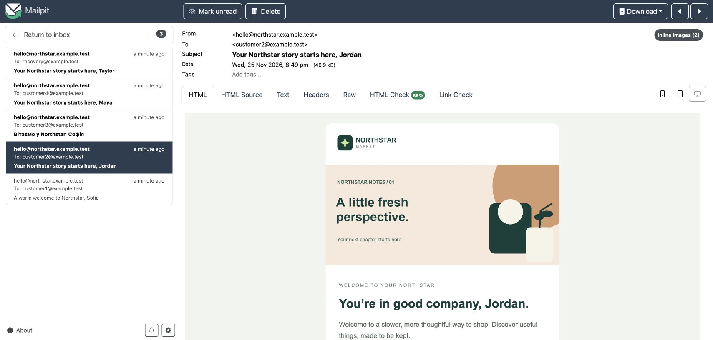

# Email image contract (Image v1)

Image v1 represents local raster bytes, never a remote URL, filesystem reference
or HTML fragment. It is an object schema annotated with `"x-voxriva-image": 1`;
there is no nonstandard JSON Schema `type: image`. Static images belong to
`draft.images`; typed context values can come from a caller or explicit
published runtime defaults.

The merge is top-level: a caller's Image replaces the whole default object.
An invalid/null override fails rather than reverting to the default. Preview
fixtures and schema `default` annotations never supply runtime bytes.

## Delivery value and SDK

An Image value is exactly:

```json
{"media_type":"image/png","content_base64":"<canonical padded base64 of actual image bytes>"}
```

PNG (`image/png`), JPEG (`image/jpeg`) and single-frame WebP (`image/webp`) are
supported. The server decodes and loads the raster, checks the claimed MIME
against the detected format, and rejects damaged images, SVG, HTML, animation,
URLs, file paths and extra object members. Each image is at most **262144 bytes**,
**4096 pixels per side** and **4000000 pixels**. Combined decoded images are at
most **1048576 bytes** in a draft (including fixtures and scenarios), a runtime
context, and the effective rendered message including static images. Duplicate
values count toward input budgets, but identical rendered bytes share a CID.
Nonimage draft/context JSON retains the 100 KB budget; rendered text/HTML retains
the 200 KB budget. These deliberately conservative limits are below SES v2's
40 MB total message limit.

Declare a variable using the complete schema in
[`../contracts/image-v1.schema.json`](../contracts/image-v1.schema.json), as a
property of the usual Draft 2020-12 object schema. Use it in HTML as
``. Object fields and list items can also
have Image schemas; use the corresponding Jinja path. Put the Image annotation directly on the property or homogeneous list item schema; image-source discovery does not infer annotations from conditional/union branches or additionalProperties. HTML autoescaping remains
enabled and there is no `safe` filter bypass.

```python
import os
from pathlib import Path
from voxriva_sdk import Client, image_from_bytes

# Existing fictional raster asset; no download or image generation is required.
banner = image_from_bytes(
    Path("scripts/demo/assets/northstar-seasonal.png").read_bytes(), "image/png"
)
context = {
    "first_name": "Taylor",
    "account_url": "https://northstar.example.test/account",
    "banner": banner,
}
with Client(os.environ["VOXRIVA_URL"], os.environ["VOXRIVA_API_KEY"]) as client:
    client.validate("northstar-welcome", recipient="person@example.test", context=context)
    accepted = client.send(
        "northstar-welcome", recipient="person@example.test", context=context,
        idempotency_key="docs:image:001",
    )
    print(accepted.id)
```

This example uses the [isolated Northstar fixture](evaluate.md) and client
environment from [API/SDK integration](journeys/integrate.md). Run from `voxriva/`.

The helper only bounds/encodes local bytes. The server is authoritative for
format, decoding, dimensions and combined budgets. Existing SDK context
mappings and existing API requests remain compatible. To use a published runtime
default, omit `banner` from context. Schema `default` and preview fixtures never
supply delivery values.

For raw HTTP, supply the same object in JSON. The complete Image schema is
available in the [downloadable contract](../contracts/image-v1.schema.json).
The SDK helper checks MIME choice and byte length only; server-side decode,
dimensions and aggregate budgets remain authoritative.

## Static authoring API and MCP

`POST /api/v1/templates/{id}/images/validate` accepts the exact Image value above,
requires dashboard editor permissions and CSRF, and returns validated content.
It creates no asset/notification/outbox record. Then save using the existing
optimistic `PUT /api/v1/templates/{id}/draft`, adding for example
`draft.images.brand_logo = <Image value>` and
`draft.html = ''`.
Names must match `[A-Za-z][A-Za-z0-9_-]{0,79}`; at most twenty static images.
Unknown static names fail preview/publication/delivery. Images are email-only.

MCP create, preview and plan/apply draft changes accept the same typed
`draft.images` and Image variable schema/value. Publication remains a separate
dashboard/API action; the MCP service has no publication tool. Their
existing credential scopes and project ownership apply; there is no upload
credential or public asset URL. Shared draft validation checks bytes before
persistence. MCP transport/change-set JSON is bounded to 6 MB to accommodate
image-bearing drafts; do not use it for arbitrary documents. `plan_changes`
remains reviewable and `apply_changes` uses its existing optimistic checks.

## Persistence, pinning, delivery and operations

Image storage is **PostgreSQL JSON**, in existing draft and immutable published
content columns. No image filesystem volume, S3 bucket, remote fetch, public URL
or new storage environment variable is needed. PostgreSQL storage capacity must
include base64 overhead (about 4/3) and retained immutable versions. Removing or
replacing a draft image cannot alter published content. Published history retains
its original images; the normal prohibition against deleting published templates
continues. Removing unused draft images is possible through the draft API; there
is no separate asset deletion endpoint or cross-template asset library.

Acceptance validates effective image bytes through the shared renderer **before**
notification/outbox insertion. Notification runtime image bytes live only in the
existing encrypted payload; the immutable template-version ID pins defaults and
static content. Idempotency fingerprints include canonical base64 content, not
an asset name alone. Broker tasks still contain only notification IDs, and
history/metrics/audit responses expose no image bytes. Existing payload expiry,
replay and terminal cleanup apply to runtime images as well. Successful delivery
clears the encrypted payload; static/published images intentionally remain.

SMTP creates a multipart/alternative message with a multipart/related HTML part
and inline image MIME parts. SES v2 `Simple.Attachments` sends the identical raw
bytes with `ContentDisposition=INLINE`, `ContentId`, `ContentType`, `FileName`
and `ContentTransferEncoding=BASE64`; boto3 encodes `RawContent` for transport.
CID identities are SHA-256 of actual bytes plus `@images.voxriva`. Preview maps
only these server-produced identities to data images before DOMPurify; the
sandbox, no-network CSP, forbidden navigation and script filtering remain active.
Preview never sends, queues or writes assets. Client-specific email rendering can
still vary; live cloud sends are not part of local checks.

Use the existing production PostgreSQL **and credential-keyring** backup/restore
procedure. PostgreSQL backups include static images, immutable published images
and encrypted queued payloads; keyring backups are needed to restore the latter.
Restore them together. No extra asset path needs coordination and no Docker or
Compose storage changes are required. External reverse proxies should permit
6 MB JSON authoring requests (each ordinary request is still validated to its
smaller semantic budgets).

Provider references: [SES attachments and 40 MB limit](https://docs.aws.amazon.com/ses/latest/dg/attachments.html),
[SES v2 Attachment contract and SDK byte encoding](https://docs.aws.amazon.com/ses/latest/APIReference-V2/API_Attachment.html).

## Observed payload override

[](assets/screenshots/payload-image-override.jpg){ .doc-media-link }

*This existing local receipt shows the alternate supplied banner. Its bytes were
transported inline; no remote image was fetched. Email-client rendering can vary.*
