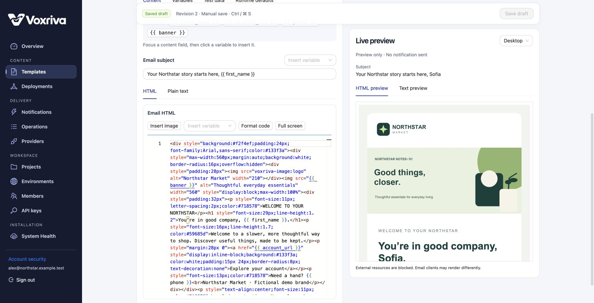

---
hide:
  - toc
---

# Email and push. Your infrastructure.

<p class="hero-lead" markdown>
**Voxriva is an open-source, self-hosted notification platform.** Manage templates,
languages and deployments in a web dashboard. Integrate through the HTTP API or
typed Python SDK, and use MCP for AI-assisted draft editing.
</p>

**MIT license · Self-hosted · Web dashboard · HTTP API · Python SDK · MCP**

[Run locally](quickstart.md){ .md-button .md-button--primary }
[Explore the dashboard](dashboard.md){ .md-button }
[API & SDK](journeys/integrate.md){ .md-button }
[Connect MCP](journeys/mcp.md){ .md-button }

## Why use Voxriva?

- **Release content without an application release.** Edit and preview templates,
  manage languages, and deploy or roll back versions per environment.
- **Keep delivery under your control.** Run on your infrastructure with your own
  SMTP, Amazon SES or Firebase Cloud Messaging credentials. No mandatory hosted
  control plane or telemetry account is required.
- **Know what happened to each message.** Validate payloads before sending and
  inspect pinned content/provider revisions, delivery attempts and failures.

[](dashboard.md){ .doc-media-link }

*Edit → preview → publish → deploy. Your team manages content and releases in the
dashboard; your application supplies recipients and runtime data.*

## Try it locally

Have Docker Engine with Compose v2 running and Python 3.10+ on macOS/Linux.
The first source build needs network downloads and can take several minutes.
No cloud account or host Node.js is needed.

From the repository root:

```sh
cd voxriva
python3 scripts/example.py
```

The isolated example prepares a fictional workspace, sends a welcome email to
local Mailpit, and prints dashboard/inbox URLs and a private login-file location.
[Get the source and send your first API email](quickstart.md).

## Send from your application

After the quickstart loads your URL/key and you
[install the Python SDK](journeys/integrate.md#configure-a-local-client):

=== "Python"

    ```python
    import os
    from voxriva_sdk import Client

    with Client(os.environ["VOXRIVA_URL"], os.environ["VOXRIVA_API_KEY"]) as client:
        accepted = client.send(
            "northstar-welcome", recipient="person@example.test", locale="en",
            context={"first_name": "Taylor", "account_url": "https://northstar.example.test/account"},
            idempotency_key="docs:welcome:001",
        )
        print(accepted.id, accepted.dashboard_url)
    ```

=== "HTTP"

    ```sh
    curl --silent --show-error --fail-with-body --noproxy '*' \
      "$VOXRIVA_URL/api/v1/notifications" \
      -H "Authorization: Bearer $VOXRIVA_API_KEY" \
      -H 'Idempotency-Key: docs:welcome:001' \
      -H 'Content-Type: application/json' \
      --data-binary @docs/examples/welcome.json
    ```

Both examples use the quickstart's deployed `northstar-welcome` template and
the same key/body, so they represent one intended message. HTTP 202 means accepted;
inspect status or the dashboard for the result. See [API/SDK integration](journeys/integrate.md).

## Choose your next step

| You want to… | Read |
| --- | --- |
| Manage templates, languages and releases with your team | [Dashboard](dashboard.md) |
| Connect application code | [API & Python SDK](journeys/integrate.md) |
| Ask an AI client to review or edit drafts | [MCP walkthrough](journeys/mcp.md) |
| Run a persistent installation | [Self-hosting](self-hosting.md) |
| Evaluate detailed behavior and scope | [Capabilities](capabilities.md), [architecture](journeys/model.md) |
| Contribute or get help | [Community](community.md) |

Own code uses [MIT](../LICENSE); dependencies have their own terms. See
[release status and compatibility](release-status.md) for current artifact
availability, supported scope and the default stack's licensing boundaries.
